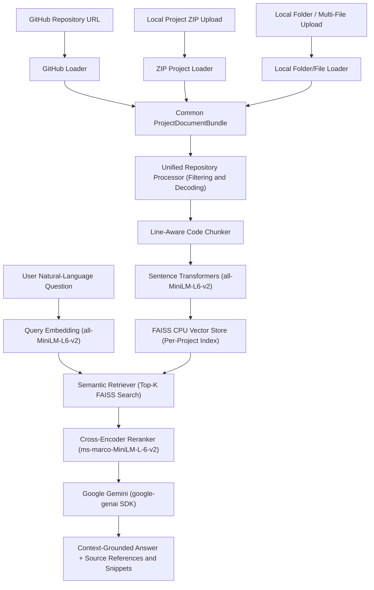

# AI-Powered GitHub Repository Assistant

## 1. Project Introduction

**AI-Powered GitHub Repository Assistant** is a Retrieval-Augmented Generation (RAG) developer assistant built with Python, Streamlit, Sentence Transformers, FAISS, Cross-Encoder reranking, and Google Gemini. It ingests complete software repositories—via a public GitHub URL, a local `.zip` archive, or a local folder/multi-file upload—and answers natural-language questions grounded strictly in the repository's actual source code and documentation, complete with file path references and line-numbered code snippets.

---

## 2. Problem Statement

Understanding an unfamiliar codebase is time-consuming: developers must manually read directory trees, trace imports across files, decipher undocumented functions, and piece together how modules interact. Standard chat LLMs without repository indexing either lack access to private/local projects or hallucinate file names and implementation details. **AI-Powered GitHub Repository Assistant** solves this by indexing real project files into a local vector store, reranking candidate code chunks with a Cross-Encoder, and generating context-grounded answers with verifiable source references.

---

## 3. Project Objectives

- Support **three unified project input methods**: public GitHub repository URL, local ZIP archive upload, and local folder / multi-file upload.
- Process all three input sources through **one unified downstream RAG pipeline** without duplicating retrieval or generation logic.
- Extract, filter, validate, and chunk source code and documentation safely without ever executing untrusted repository code.
- Generate dense vector embeddings using `all-MiniLM-L6-v2` and store them in isolated per-project `faiss-cpu` indexes.
- Improve retrieval precision using `cross-encoder/ms-marco-MiniLM-L-6-v2` reranking.
- Generate clear, grounded technical and beginner-friendly answers via the official `google-genai` SDK.
- Present verified source file paths, line ranges, and code snippets alongside every answer.

---

## 4. Key Features

- **Three Input Modes**: Public GitHub URL loader, safe ZIP archive extractor, and local folder / multiple-file uploader.
- **Unified Processing Pipeline**: Common `ProjectDocumentBundle` -> `ProcessedRepository` representation across all inputs.
- **Security-First Ingestion**: ZIP path-traversal protection, symlink rejection, archive size & file-count limits, binary filtering, prompt-injection isolation (`<UNTRUSTED_REPOSITORY_CONTEXT>`), and zero execution of repository code.
- **Line-Aware Code Chunking**: Preserves relative paths, file names, language metadata, and exact `start_line`–`end_line` ranges.
- **Semantic Search + Cross-Encoder Reranking**: Two-stage retrieval combining fast FAISS cosine similarity (`IndexFlatIP` over L2-normalized vectors) with Cross-Encoder relevance scoring.
- **Grounded Gemini Answers & Source Citations**: Displays exact file paths, line numbers, similarity/rerank scores, and syntax-highlighted code snippets.
- **Interactive Streamlit Dashboard**: Project metrics, language breakdown, indexed file browser, configurable RAG hyperparameters, chat history, and project reset controls.

---

## 5. Technology Stack

| Component | Technology |
| :--- | :--- |
| **Language** | Python 3.11.9 (64-bit) |
| **Frontend** | Streamlit |
| **Repository Access** | GitHub REST API (`requests`), ZIP extraction (`zipfile`) |
| **Embeddings** | Sentence Transformers (`all-MiniLM-L6-v2`, CPU) |
| **Vector Database** | FAISS CPU (`faiss-cpu`, `IndexFlatIP`) |
| **Reranking** | Cross-Encoder (`cross-encoder/ms-marco-MiniLM-L-6-v2`, CPU) |
| **LLM** | Google Gemini API via official `google-genai` Python SDK |
| **Utilities & Testing** | NumPy, Pandas, python-dotenv, pytest |

---

## 6. Three Supported Input Methods

1. **GitHub Repository URL** (`src/github_loader.py`):
   - Validates `https://github.com/owner/repository-name` (including `.git` and `/tree/branch` URLs).
   - Fetches repository metadata via the GitHub REST API and downloads the repository archive safely.
   - Handles invalid URLs, 404/private repositories, empty repositories, API rate limits, and network timeouts.

2. **Local Project ZIP Upload** (`src/local_project_loader.py`):
   - Accepts `.zip` archives via Streamlit's file uploader.
   - Validates archive size and uncompressed totals, prevents path-traversal (`..`, absolute paths, symlinks), extracts to an isolated temporary directory, and preserves relative paths across nested directories.

3. **Local Project Folder / Multiple-File Upload** (`src/local_project_loader.py`):
   - Uses Streamlit's directory upload mode (`accept_multiple_files="directory"`) where supported by the browser (Chromium, Edge, Firefox) and provides a Multiple-File Selection alternative if directory picking is unsupported or unavailable.
   - Preserves relative directory structure when provided by the browser and groups files under the detected project root.

---

## 7. RAG Architecture

All three loaders produce a common `ProjectDocumentBundle` that flows into the same downstream pipeline:

1. **Repository Processor** (`src/repository_processor.py`): Excludes noisy directories (`.git`, `node_modules`, `__pycache__`, `venv`, `dist`, `build`, etc.), filters unsupported/binary/empty/oversized files, safely decodes text, and computes a deterministic `project_id`.
2. **Code Chunker** (`src/chunking.py`): Splits files into configurable overlapping, line-numbered `CodeChunk` objects.
3. **Embedding Generator** (`src/embeddings.py`): Encodes chunks and user queries with cached `all-MiniLM-L6-v2` embeddings on CPU.
4. **FAISS Vector Store** (`src/vector_store.py`): Stores normalized vectors in isolated per-project `faiss.IndexFlatIP` indexes and skips redundant re-indexing when content has not changed.
5. **Semantic Retriever** (`src/retriever.py`): Embeds natural-language questions and retrieves the top-K candidate chunks from the active project index.
6. **Cross-Encoder Reranker** (`src/reranker.py`): Scores `(question, chunk)` pairs using cached `cross-encoder/ms-marco-MiniLM-L-6-v2` and selects the top-K most relevant snippets.
7. **Gemini Answer Generator** (`src/gemini_llm.py`): Sends grounded context wrapped in untrusted-data delimiters to Google Gemini via `google-genai` and returns a structured answer with verified source citations.

---

## 8. System Workflow

1. In the unified **Analyze Your Project** section, choose a source (**GitHub Repository URL**, **Upload ZIP**, or **Upload Project Folder**).
2. Provide the repository URL, `.zip` archive, or project folder and click **Analyze Repository**, **Analyze ZIP**, or **Analyze Folder** to run filtering, chunking, embedding generation, and FAISS indexing.
3. Review the **Project Summary** card (total discovered files, indexed files, skipped files, total lines, and language breakdown) and the sidebar **Project Status** / **Gemini API Status**.
4. Ask a natural-language question in the dark-themed AI chat interface and click **Send** (or click an example question).
5. Review the grounded answer alongside expandable **Source References** showing exact relative file paths, line ranges, and code snippets.

---

## 9. Architecture Diagram



---

## 10. Project Folder Structure

```text
ai-powered-github-repository-assistant/
├── app.py
├── config.py
├── requirements.txt
├── .env.example
├── .gitignore
├── README.md
├── src/
│   ├── __init__.py
│   ├── github_loader.py
│   ├── local_project_loader.py
│   ├── repository_processor.py
│   ├── chunking.py
│   ├── embeddings.py
│   ├── vector_store.py
│   ├── retriever.py
│   ├── reranker.py
│   ├── gemini_llm.py
│   └── rag_pipeline.py
├── utils/
│   ├── __init__.py
│   ├── helpers.py
│   └── logger.py
├── tests/
│   ├── test_github_loader.py
│   ├── test_local_project_loader.py
│   ├── test_repository_processor.py
│   ├── test_chunking.py
│   ├── test_retriever.py
│   └── test_rag_pipeline.py
└── data/
```

---

## 11. Installation Instructions

Ensure **Python 3.11.9 (64-bit)** and **Git** are installed on your system.

```powershell
cd ai-powered-github-repository-assistant
```

---

## 12. Python Environment Setup

### Windows PowerShell
```powershell
python -m venv venv
.\venv\Scripts\Activate.ps1
```

### Windows Command Prompt (CMD)
```cmd
python -m venv venv
venv\Scripts\activate.bat
```

---

## 13. Dependency Installation

```powershell
python -m pip install --upgrade pip
pip install -r requirements.txt
```

---

## 14. Gemini API Key Configuration

1. Obtain an API key from Google AI Studio: https://aistudio.google.com/apikey
2. Copy `.env.example` to `.env` in the project root:
   - PowerShell: `Copy-Item .env.example .env`
   - CMD: `copy .env.example .env`
3. Edit `.env` and set your key:

```env
GEMINI_API_KEY=your_actual_api_key_here
GEMINI_MODEL=gemini-3.7-flash
```

Optionally, add `GITHUB_TOKEN=...` in `.env` to increase GitHub REST API rate limits. Never commit `.env` to GitHub.

---

## 15. How to Run the Application

```powershell
streamlit run app.py
```

Open the local URL displayed in the terminal (typically `http://localhost:8501`).

---

## 16. Example Questions

1. What is the purpose of this project?
2. Explain the overall project architecture.
3. Explain the main application file.
4. How does authentication work?
5. Which libraries and frameworks are used?
6. Explain a particular function or class.
7. How does data flow through the application?
8. What are the important modules and how are they connected?
9. Identify possible improvements or refactoring opportunities.
10. Explain the execution flow from entry point to output.

---

## 17. Testing Instructions

Run the full automated `pytest` test suite:

```powershell
pytest -v
```

The test suite covers GitHub URL parsing & error handling, ZIP & folder ingestion (including path-traversal and size checks), repository filtering, line-aware chunking, FAISS vector store isolation, semantic retrieval, and end-to-end unified pipeline tests.

---

## 18. Screenshots

> Run `streamlit run app.py` to launch the dark-themed SaaS dashboard featuring the unified **Analyze Your Project** selector (**GitHub Repository URL**, **Upload ZIP**, **Upload Project Folder**), **Project Summary**, sidebar status panel, and **AI Chat + Source References** view. Add screenshots to a `docs/` folder if desired when publishing to GitHub.

---

## 19. Limitations

- **Public GitHub Repositories Only** (unless `GITHUB_TOKEN` with appropriate access is provided in `.env`).
- **Browser Folder Upload Support**: `accept_multiple_files="directory"` relies on browser `webkitdirectory` support; browsers without directory upload support can use Multiple-File Selection or ZIP Upload.
- **CPU Inference Latency**: Running `all-MiniLM-L6-v2` and `cross-encoder/ms-marco-MiniLM-L-6-v2` on CPU is memory-efficient, though large repositories with thousands of chunks take longer during initial embedding.
- **In-Memory Session Indexes**: FAISS indexes are stored per active session in memory and cleared on project reset or server restart.
- **File & Archive Limits**: Individual source files above 1 MB and archives above 200 MB are skipped or rejected to protect memory.

---

## 20. Future Enhancements

- Persistent on-disk FAISS index caching keyed by commit SHA / project hash.
- AST-aware chunking for Python, Java, JavaScript, and TypeScript functions and classes.
- Support for comparing two branches or pull request diffs.
- Exportable Markdown architecture reports generated from repository analysis.

---

## Git & GitHub Preparation

```powershell
git init
git add .
git commit -m "Initial commit: AI-Powered GitHub Repository Assistant"
git branch -M main
git remote add origin YOUR_GITHUB_REPOSITORY_URL
git push -u origin main
```
