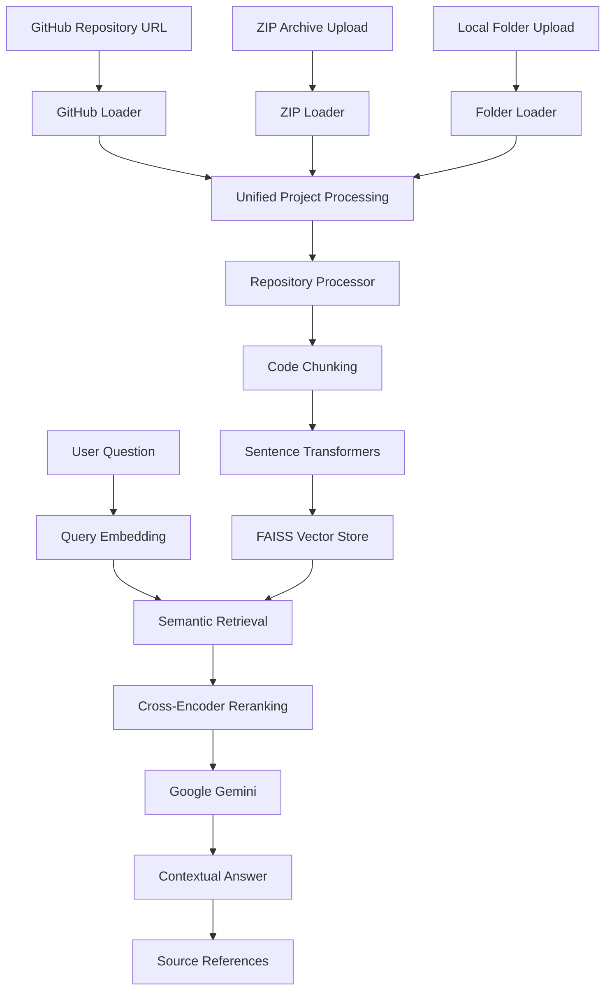

# 🚀 AI-Powered GitHub Repository Assistant

An intelligent codebase analysis assistant powered by **Retrieval-Augmented Generation (RAG)** that understands software repositories and answers natural-language questions with accurate source-code references.

## 🌐 Live Demo

**Try the application:**

🔗 **Live Application:** [ADD YOUR DEPLOYED APP LINK HERE]

**GitHub Repository:** [AI-Powered GitHub Repository Assistant](https://github.com/Anusha1839/AI-Powered-GitHub-Repository-Assistant)

The application is deployed using Streamlit Community Cloud.

---

## 📌 1. Project Introduction

**AI-Powered GitHub Repository Assistant** is an AI-powered developer assistant designed to simplify understanding and exploring software codebases.

It uses Retrieval-Augmented Generation (RAG), Sentence Transformers, FAISS vector search, Cross-Encoder reranking, and Google Gemini to analyze software repositories and answer questions based on their actual source code and documentation.

Users can provide a GitHub repository URL, upload a ZIP archive, or upload local project files. The application processes the repository, retrieves relevant code snippets, and generates contextual answers with file paths, line numbers, and source-code references.

## 🎯 2. Problem Statement

Understanding an unfamiliar software project can be time-consuming. Developers often need to manually explore directory structures, trace dependencies, understand functions, and identify relationships between different modules.

General-purpose AI chatbots may not have access to the actual project files and can sometimes generate incorrect file names or implementation details.

This project addresses these challenges by:

- Automatically analyzing software repositories.
- Extracting and indexing source-code files.
- Finding relevant code using semantic search.
- Improving retrieval accuracy through reranking.
- Generating context-aware answers using Google Gemini.
- Providing verifiable source-code references.

## 🎯 3. Project Objectives

- Support GitHub repository URLs, ZIP uploads, and local project folder uploads.
- Process all input sources through one unified RAG pipeline.
- Extract and filter source code and documentation safely.
- Generate embeddings using Sentence Transformers.
- Store and retrieve vector embeddings using FAISS.
- Improve retrieval relevance using Cross-Encoder reranking.
- Generate accurate, contextual answers using Google Gemini.
- Display relevant file paths, line numbers, and code snippets.

## ✨ 4. Key Features

- **Multiple Input Sources:** Analyze GitHub repositories, ZIP archives, and local project folders.
- **Automated Repository Analysis:** Extracts, filters, processes, and indexes project files.
- **Retrieval-Augmented Generation:** Uses retrieved code context to generate relevant answers.
- **Semantic Code Search:** Finds relevant code using Sentence Transformers and FAISS.
- **Cross-Encoder Reranking:** Improves the relevance of retrieved code snippets.
- **AI-Powered Code Explanations:** Uses Google Gemini to explain project architecture, functions, modules, and implementation details.
- **Source-Code References:** Displays relevant file paths, line ranges, and code snippets.
- **Interactive Chat Interface:** Allows users to ask natural-language questions about their analyzed codebase.
- **Modern Dark UI:** Provides a clean and developer-friendly interface.

## 🛠️ 5. Technology Stack

| Component | Technology |
|---|---|
| Programming Language | Python |
| Frontend | Streamlit |
| AI Architecture | Retrieval-Augmented Generation (RAG) |
| Embedding Model | Sentence Transformers |
| Embedding Model Name | all-MiniLM-L6-v2 |
| Vector Database | FAISS CPU |
| Retrieval | Semantic Similarity Search |
| Reranking | Cross-Encoder |
| Reranker Model | cross-encoder/ms-marco-MiniLM-L-6-v2 |
| Large Language Model | Google Gemini |
| Gemini Integration | google-genai SDK |
| Data Processing | NumPy, Pandas |
| Testing | Pytest |

## 📂 6. Supported Input Methods

### 1. GitHub Repository URL

- Accepts public GitHub repository URLs.
- Retrieves repository files using the GitHub REST API.
- Downloads and processes repository archives.
- Handles invalid URLs, unavailable repositories, API rate limits, and network errors.

### 2. Upload ZIP Archive

- Accepts compressed project ZIP files.
- Extracts source-code files safely.
- Preserves nested directory structures.
- Validates archive size and file contents.
- Prevents unsafe archive path traversal.

### 3. Upload Local Project Folder

- Supports local project folder selection where the browser allows directory uploads.
- Also supports multiple-file selection.
- Preserves relative file paths when provided by the browser.
- Processes uploaded files through the same RAG pipeline.

## 🧠 7. RAG Architecture

The application follows a unified Retrieval-Augmented Generation pipeline.

All three input methods use the same downstream processing architecture.

### Repository Processing Workflow

1. **Repository Ingestion:** Reads files from GitHub, ZIP archives, or local project uploads.
2. **Repository Processing:** Filters unsupported, binary, empty, and unnecessary files.
3. **Code Chunking:** Splits source files into smaller overlapping chunks while preserving line numbers and metadata.
4. **Embedding Generation:** Converts code chunks into numerical vector representations using Sentence Transformers.
5. **Vector Storage:** Stores embeddings in FAISS for efficient similarity search.

### Question Answering Workflow

6. **Query Embedding:** Converts the user's natural-language question into a vector representation.
7. **Semantic Retrieval:** Retrieves relevant code chunks from the FAISS index.
8. **Cross-Encoder Reranking:** Reorders retrieved results according to their relevance to the question.
9. **Gemini Answer Generation:** Uses the retrieved repository context to generate an answer.
10. **Source References:** Displays relevant file paths, line numbers, and code snippets alongside the answer.

### Architecture Diagram



## 🔄 8. Application Workflow

1. Open the deployed application or run it locally.
2. Select a project input method.
3. Provide a GitHub repository URL, ZIP archive, or local project files.
4. Click **Analyze Repository**.
5. Wait for the repository to be processed and indexed.
6. Once analysis is complete, the chat interface becomes available.
7. Ask natural-language questions about the codebase.
8. Review AI-generated explanations and relevant source-code references.

## 💬 9. Example Questions

Users can ask questions such as:

1. What is the purpose of this project?
2. Explain the overall project architecture.
3. Explain the main application file.
4. Which libraries and frameworks are used?
5. How does the RAG pipeline work?
6. How are embeddings generated?
7. How does FAISS retrieve relevant code?
8. Explain a particular function or class.
9. How are different modules connected?
10. Explain the execution flow from input to output.

## 📁 10. Project Folder Structure

```text
AI-Powered-GitHub-Repository-Assistant/
│
├── app.py
├── config.py
├── requirements.txt
├── .env.example
├── .gitignore
├── README.md
│
├── src/
│   ├── __init__.py
│   ├── github_loader.py
│   ├── local_project_loader.py
│   ├── repository_processor.py
│   ├── chunking.py
│   ├── embeddings.py
│   ├── vector_store.py
│   ├── retriever.py
│   ├── reranker.py
│   ├── gemini_llm.py
│   └── rag_pipeline.py
│
├── utils/
│   ├── __init__.py
│   ├── helpers.py
│   └── logger.py
│
├── tests/
│   ├── test_github_loader.py
│   ├── test_local_project_loader.py
│   ├── test_repository_processor.py
│   ├── test_chunking.py
│   ├── test_retriever.py
│   ├── test_rag_pipeline.py
│   └── test_ui_app.py
│
└── data/
```

## 💻 11. Installation Instructions

### Prerequisites

- Python 3.11.9 (64-bit)
- Git
- Visual Studio Code (recommended)
- Google Gemini API key

### Step 1: Clone the Repository

```bash
git clone https://github.com/Anusha1839/AI-Powered-GitHub-Repository-Assistant.git
```

### Step 2: Navigate to the Project Directory

```bash
cd AI-Powered-GitHub-Repository-Assistant
```

## 🐍 12. Virtual Environment Setup

### Windows PowerShell

```powershell
python -m venv venv
venv\Scripts\Activate.ps1
```

### Windows Command Prompt

```cmd
python -m venv venv
venv\Scripts\activate.bat
```

## 📦 13. Install Dependencies

Upgrade pip:

```bash
python -m pip install --upgrade pip
```

Install all required packages:

```bash
pip install -r requirements.txt
```

## 🔑 14. Gemini API Configuration

The application uses Google Gemini to generate context-aware answers based on retrieved repository content.

### Get a Gemini API Key

Visit [Google AI Studio](https://aistudio.google.com/apikey) and create an API key.

### Local Configuration

1. Copy `.env.example` to `.env`.

PowerShell:

```powershell
Copy-Item .env.example .env
```

2. Open `.env` and configure:

```env
GEMINI_API_KEY=your_actual_api_key_here
GEMINI_MODEL=gemini-3.7-flash
```

3. Save the file.

**Security:** Never upload your `.env` file or expose your API key in public repositories.

### Deployed Application Configuration

For the deployed Streamlit application, the application owner must configure the Gemini API key through Streamlit Community Cloud Secrets.

1. Open [Streamlit Community Cloud](https://share.streamlit.io/).
2. Select the deployed application.
3. Navigate to **Settings → Secrets**.
4. Add the following TOML configuration:

```toml
GEMINI_API_KEY = "your_actual_gemini_api_key"
GEMINI_MODEL = "gemini-3.7-flash"
```

5. Save the configuration and allow the application to restart.

**Important:** The application owner configures the API key once. Recruiters and other users do not need to provide their own API keys to use the application.

## ▶️ 15. Run the Application Locally

After installing dependencies and configuring the Gemini API key, run:

```bash
streamlit run app.py
```

Open the local URL displayed in the terminal, typically:

```text
http://localhost:8501
```

## ☁️ 16. Deployment

The application is deployed using **Streamlit Community Cloud**.

### Deployment Steps

1. Push the project source code to GitHub.
2. Visit [Streamlit Community Cloud](https://share.streamlit.io/).
3. Sign in using your GitHub account.
4. Select **Create App**.
5. Choose the project repository.
6. Select the `main` branch.
7. Set the main file path to `app.py`.
8. Configure the required Gemini API key through Streamlit Secrets.
9. Click **Deploy**.

After successful deployment, the application will be accessible through its public Streamlit URL.

**Live Demo:** [ADD YOUR DEPLOYED APP LINK HERE]

## 🧪 17. Testing Instructions

Run the automated test suite:

```bash
pytest -v
```

The tests cover:

- GitHub repository URL parsing and error handling.
- ZIP archive ingestion.
- Local folder and multiple-file ingestion.
- Archive path-traversal and size validation.
- Repository filtering and processing.
- Line-aware code chunking.
- FAISS vector storage.
- Semantic retrieval.
- RAG pipeline functionality.
- Application interface tests.

## 📸 18. Screenshots

### Application Interface

[Add your application screenshot here]

### Repository Analysis

[Add your repository analysis screenshot here]

### AI Chat and Source References

[Add your AI chat screenshot here]

## ⚠️ 19. Limitations

- **Public GitHub Repositories:** Private repositories require an appropriate GitHub token.
- **Browser Folder Upload:** Directory upload support depends on browser capabilities. ZIP upload and multiple-file selection are alternatives.
- **CPU Processing:** Sentence Transformer embeddings and Cross-Encoder reranking run on CPU, so large repositories may require additional processing time.
- **In-Memory Vector Indexes:** FAISS indexes are maintained for the active application session and may be cleared when the session or server restarts.
- **File Size Restrictions:** Individual source files and archives are subject to configured size limits to manage memory usage.

## 🔮 20. Future Enhancements

- Persistent FAISS vector index caching.
- AST-aware code chunking for Python, Java, JavaScript, and TypeScript.
- Git branch and pull request comparison.
- Automated architecture documentation.
- Exportable Markdown reports.
- Improved support for large software repositories.

## 🔒 21. Security Considerations

- API keys are stored using environment variables or Streamlit Secrets.
- Sensitive credentials are excluded from Git version control.
- Uploaded repositories are treated as untrusted input.
- Repository code is analyzed as text and is never executed.
- ZIP extraction includes path-traversal protection and file validation.

---

## 👩‍💻 Author

**Dhanusha Katakam Ediga**

AI & ML Graduate | Aspiring AI Engineer

**GitHub:** [Anusha1839](https://github.com/Anusha1839)

**LinkedIn:** [Dhanusha Katakam Ediga](https://www.linkedin.com/in/dhanusha1839/)

---

⭐ If you find this project useful, consider giving the repository a star!
